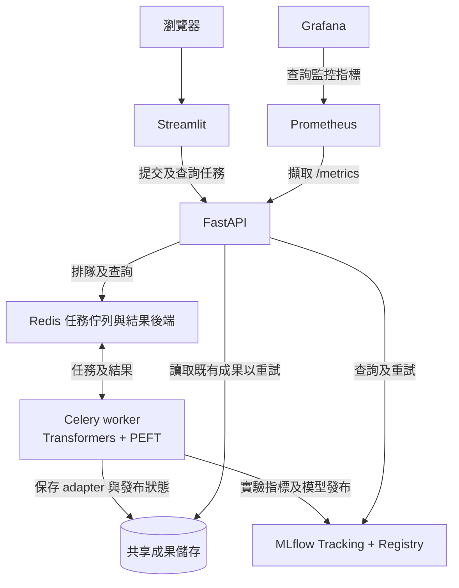

# LoRA 微調平台

[English](README.md)

提交並追蹤 Transformer 文字分類模型的 LoRA 微調任務。平台在排隊前驗證訓練設定，由背景 worker 執行訓練，保存 adapter 與評估指標，再將模型版本發布到 MLflow。發布失敗後可以沿用已保存的訓練成果重試。

本專案由個人開發，獲得 2025 iThome 鐵人賽生成式 AI 組佳作。 [30 天開發系列文章](https://ithelp.ithome.com.tw/users/20151660/ironman/8264) · [展示影片](docs/demo.mp4)

## 快速開始

需要 Docker Engine、Docker Compose v2.24.4 以上，以及可下載 Python 依賴、容器映像和 Hugging Face 資源的網路。請在 repo 根目錄操作，第一次啟動時先複製環境變數範本並設定本機 JWT 密鑰。

```bash
cp -n .env.example .env
mkdir -p logs
# 啟動前先設定 .env 中的 JWT_SECRET。
docker compose -f docker-compose.yml -f docs/compose.local.yml up -d --build ui worker
```

1. 開啟 [Streamlit](http://localhost:8501)，按 **訪客登入**。
2. 在 **提交任務** 選擇 `distilbert-base-uncased` 和 `glue/sst2`。小型 CPU 驗證可以用 100 筆訓練樣本、50 筆驗證樣本、batch size 2、1 epoch，裝置沿用 CPU 映像的預設值。
3. 在 **追蹤進度** 使用自動帶入的 ID 或貼上任務 ID，查看訓練指標與發布狀態。開啟 [MLflow](http://localhost:5001) 可以查看實驗和已註冊的模型。

本機覆寫會建置只含 CPU 版 PyTorch 的映像。第一次訓練可能需要下載模型權重及資料集。Compose 的 worker 預設上限為 **1 核 CPU、4 GiB RAM，無額外 swap**。本機覆寫會將公開連接埠綁定至 loopback，並提供應用程式的日誌目錄。示範登入供本機使用。

**Linux x86-64 實測（2026-11-24）。** 在基底與服務映像已有快取的情況下，全新 Compose 專案約 2 分 5 秒完成建置與啟動。範例任務從提交到取得最終結果約 3 分 29 秒，其中訓練器回報 137 秒。此次 worker 記憶體峰值為 1.27 GiB，MLflow 模型版本 1 已就緒。

需要監控時，執行 `docker compose -f docker-compose.yml -f docs/compose.local.yml up -d prometheus grafana`，再開啟 [Grafana](http://localhost:3000)。要停止服務並保留資料，執行 `docker compose -f docker-compose.yml -f docs/compose.local.yml stop`。

## 系統架構



1. FastAPI 使用 Pydantic 驗證巢狀設定，再提交到 Celery 並回傳任務 ID。Redis 負責佇列與結果儲存。
2. Worker 載入模型和資料集、訓練及評估 LoRA adapter，保存 adapter 與發布狀態。MLflow 記錄實驗和指標。
3. Worker 將模型版本發布到 MLflow。若訓練完成後的打包或註冊失敗，任務會保留訓練指標，並顯示發布失敗。在 **追蹤進度** 可按 **重試模型發布**，沿用已保存的成果。如果同一個 run 和模型已有 Registry 版本，重試會沿用該版本。

選用的[推論服務](app/tasks/inference.py) 透過 `MODEL_PATH` 讀取本機訓練成果，載入基礎模型和 adapter，可自行獨立啟動。

## API

完整的請求格式和回應定義請見 [Swagger UI](http://localhost:8000/docs)。

| 端點 | 用途 |
| --- | --- |
| `POST /auth/login` | 取得示範環境的 JWT |
| `POST /train` | 驗證設定並將任務排入佇列 |
| `GET /task/{task_id}` | 查詢訓練結果及發布狀態 |
| `POST /task/{task_id}/publication/retry` | 重試發布已完成的訓練成果 |
| `GET /mlflow` | 查詢 MLflow 實驗紀錄 |
| `GET /metrics` | 提供 Prometheus 指標 |

## 開發與部署

| 路徑 | 內容 |
| --- | --- |
| [`app/api/routes/`](app/api/routes/) | 提交、狀態、認證及模型查詢 |
| [`app/tasks/`](app/tasks/) 和 [`app/train/`](app/train/) | Worker 入口、訓練流程及發布重試 |
| [`config/`](config/) | 模型與訓練的 YAML 預設 |
| [`tests/`](tests/) | API、worker、監控及發布迴歸測試 |
| [`charts/finetune-platform/`](charts/finetune-platform/) | Helm 模板與部署設定 |

使用 Python 3.11，在 repo 根目錄安裝依賴並執行測試。

```bash
python -m pip install -r requirements.txt
python -m pytest tests/
python -m flake8
```

GitHub Actions 在 push 和 pull request 執行 lint 與測試。使用 `make helm-dryrun` 可在本機渲染 Kubernetes manifests。部署時請參考 [Kubernetes 文件](k8s/README.md) 和 [Helm values](charts/finetune-platform/values.yaml) 中的映像、worker 和儲存設定。

## 部署適用範圍

- 本機 Compose 使用 SQLite 儲存 MLflow metadata，並以 bind mount 保存成果。發布重試要求 API 和 worker 能讀到同一份 adapter 及發布狀態。
- 示範環境提供訪客登入及範例角色。多人共用部署須配置自己的身分驗證、網路存取、密鑰及儲存。
- 訓練支援 CPU、CUDA 和 Apple MPS，依執行環境選擇。本機 Compose 快速開始以 CPU 為目標。
