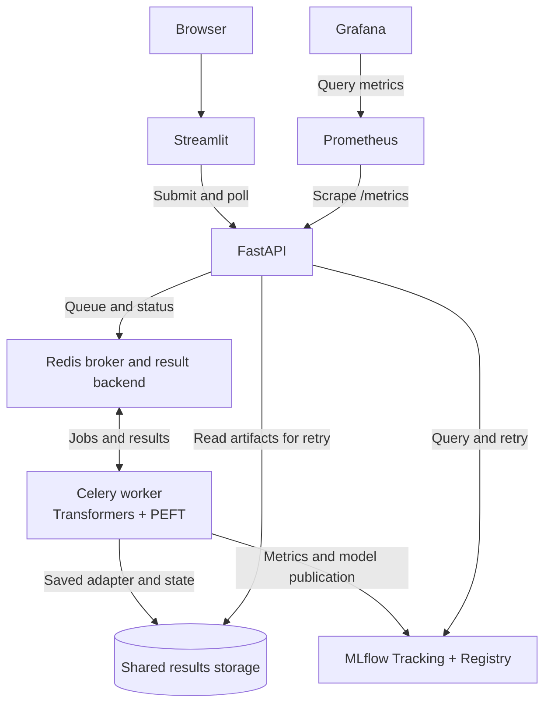

# LoRA Fine-Tune Platform

[繁體中文](README-zh.md)

Submit and track LoRA fine-tuning jobs for transformer text classifiers. The platform validates training settings at submission, runs training in a background worker, saves adapters and evaluation metrics, and publishes model versions to MLflow. A failed publication can be retried from the saved training output.

Built solo for the 2025 iThome Ironman challenge and awarded an honorable mention in the Generative AI track. [30-day engineering series](https://ithelp.ithome.com.tw/users/20151660/ironman/8264) · [Demo video](docs/demo.mp4)

## Quickstart

Requires Docker Engine, Docker Compose v2.24.4 or newer, and access to download Python dependencies, container images, and Hugging Face assets. Run from the repository root. For a fresh setup, copy the environment template and set a local JWT secret.

```bash
cp -n .env.example .env
mkdir -p logs
# Set JWT_SECRET in .env before starting.
docker compose -f docker-compose.yml -f docs/compose.local.yml up -d --build ui worker
```

1. Open [Streamlit](http://localhost:8501) and choose **訪客登入** (guest login).
2. Open **提交任務** (submit job). Choose `distilbert-base-uncased` and `glue/sst2`. For a small CPU run, use 100 training samples, 50 evaluation samples, batch size 2, 1 epoch, and the CPU device.
3. Copy the task ID or use the prefilled ID in **追蹤進度** (track progress). The result shows the training metrics and publication status. Open [MLflow](http://localhost:5001) to inspect the run and registered model.

The first run may download model weights and datasets. The Compose worker defaults to **1 CPU and 4 GiB RAM**, with no additional swap. The local overlay binds the published ports to loopback and supplies the application log directory. The demo login is intended for local use.

To add monitoring, run `docker compose -f docker-compose.yml -f docs/compose.local.yml up -d prometheus grafana` and open [Grafana](http://localhost:3000). To stop the stack and retain its data, run `docker compose -f docker-compose.yml -f docs/compose.local.yml stop`.

## Architecture



1. FastAPI validates the nested Pydantic configuration and returns a Celery task ID. Redis serves as the broker and result backend.
2. The worker loads the model and dataset, trains and evaluates the LoRA adapter, then saves the adapter and publication state. MLflow records the run and metrics.
3. The worker publishes a model version to MLflow. If packaging or registration fails after training, the task result retains the metrics and shows publication as failed. From **追蹤進度**, choose **重試模型發布** to publish from saved output. A retry reuses an existing Registry version found for the same run and model.

The optional [inference service](app/tasks/inference.py) loads a base model and adapter from a local training output via `MODEL_PATH`. It runs separately from the default Compose services.

## API

Open [Swagger UI](http://localhost:8000/docs) for request schemas and response details.

| Endpoint | Purpose |
| --- | --- |
| `POST /auth/login` | Obtain a demo JWT |
| `POST /train` | Validate and queue a job |
| `GET /task/{task_id}` | Read training results and publication status |
| `POST /task/{task_id}/publication/retry` | Retry publishing a completed training result |
| `GET /mlflow` | Browse MLflow runs |
| `GET /metrics` | Expose Prometheus metrics |

## Development and deployment

| Location | What to look for |
| --- | --- |
| [`app/api/routes/`](app/api/routes/) | Submission, status, authentication, and model queries |
| [`app/tasks/`](app/tasks/) and [`app/train/`](app/train/) | Worker entry point, training loop, and publication retry |
| [`config/`](config/) | YAML model and training presets |
| [`tests/`](tests/) | API, worker, monitoring, and publication regression tests |
| [`charts/finetune-platform/`](charts/finetune-platform/) | Helm templates and deployment values |

With Python 3.11, install test dependencies and run the test suite from the repository root.

```bash
python -m pip install -r requirements.txt
python -m pytest tests/
python -m flake8
```

GitHub Actions runs lint and tests on pushes and pull requests. To render the Kubernetes manifests locally, use `make helm-dryrun`. See the [Kubernetes notes](k8s/README.md) and review the [Helm values](charts/finetune-platform/values.yaml) for image, worker, and storage configuration.

## Deployment boundaries

- Local Compose uses SQLite for MLflow metadata and bind mounts for results. Publication retry requires the API and worker to see the same saved adapter and publication state.
- The demo includes guest login and example role handling. A shared deployment needs its own identity, network access, secrets, and storage configuration.
- Training resolves CPU, CUDA, or Apple MPS based on the runtime. The local Compose quickstart targets CPU.
